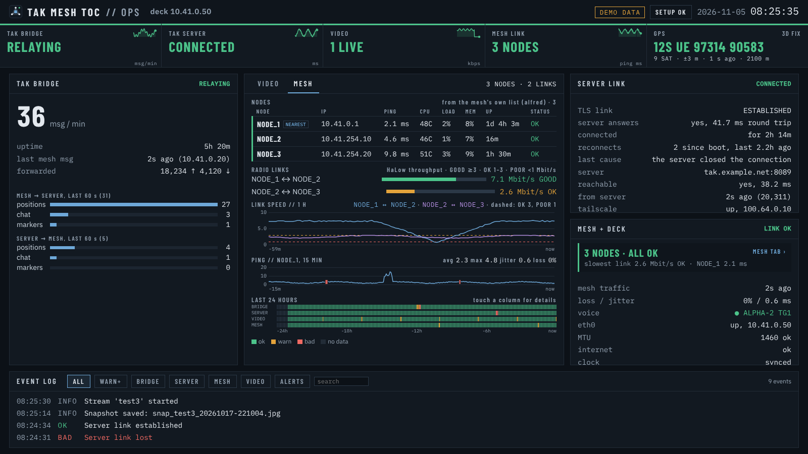
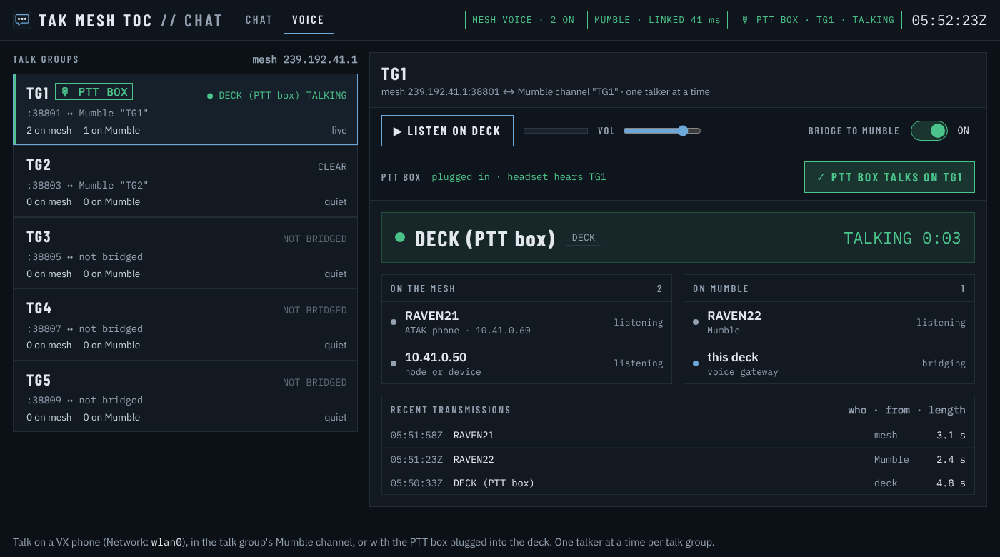

<p align="center">
  
</p>

<p align="center">
  <b>Take your ATAK team somewhere with no cell service, and still see and talk to everyone back on your TAK server.</b><br>
  One small Linux computer (the "deck") joins the phones on your mesh radios to your TAK server:
  positions, chat, photos, push-to-talk voice and video, both ways.
  The phones on the mesh need no internet, no server account and no certificate.
</p>

<p align="center">
  
  
  
  
</p>

---

## What it does

- **Everyone on one map.** Phones on the mesh show up on your TAK server, and people on the server show up on the mesh phones.
- **Chat and direct messages** between the mesh and the server, plus chat on the deck's own screen.
- **Share photos and data packages** from a mesh phone to the server, and back.
- **Push-to-talk voice.** Talk groups on the mesh are linked to channels on a Mumble server, and the deck operator can talk too with a headset.
- **Live video.** Streams show on the TAK map as markers you tap to watch.
- **Keeps working when the link drops.** The mesh carries on by itself, and the deck holds messages until the server is back.

**Who it's for:** teams that already use ATAK or iTAK and need to work where cell coverage is weak or gone: search and
rescue, event safety, emergency communications, off-grid groups, and anyone building their own mesh network.

## How it works

<p align="center"></p>

The phones talk to each other over the mesh radios, just as ATAK normally does on a local network. The deck is wired
to one mesh node and also has a link to your TAK server (Wi-Fi, a hotspot or a VPN). It passes traffic between the two,
so only the deck ever needs that link.

## What you need

| | What | Tested with |
|---|---|---|
| **The deck** | A small Linux computer with two network connections: a cable to a mesh node, and Wi-Fi or a hotspot to reach your server | Raspberry Pi 4 and 5, Raspberry Pi OS 12 |
| **Mesh radios** | Mesh nodes your phones connect to, which pass ATAK's local traffic | OpenMANET HaLow |
| **A TAK server** | Plus one data package for the deck, made the same way you'd make one for a phone | OpenTAKServer 1.7 |
| **Phones** | ATAK (Android) or iTAK (iPhone) | |
| *Optional* | A USB GPS, a Mumble server for voice, a USB push-to-talk headset box, MediaMTX for video | |

## Get started

1. Download **`TAK_MESH_TOC.zip`** from [Releases](../../../releases) and copy it to the deck.
2. On the deck, open a terminal and paste:
   ```
   unzip TAK_MESH_TOC.zip && cd TAK_MESH_TOC && bash install.sh --icon
   ```
3. Click the **TAK MESH TOC Ops** icon. The setup wizard asks for the deck's data package, its callsign and a few
   choices, then checks that everything works.

No internet is needed to install: everything it uses is in the zip.

<p align="center">
  
  
</p>
<p align="center">
  
</p>

## What's included

| Part | What it does |
|---|---|
| **Bridge** | Joins the mesh and the server: positions, chat, markers, routes, drawings and private messages. Phones can move between the mesh and the server and stay reachable |
| **Files** | Photos, data packages and map overlays both ways, for ATAK and iTAK |
| **Chat** | ATAK chat on the deck's screen, mesh and server, with quick keys and report forms |
| **Ops** | A status screen for the whole setup: server link, every mesh node and its signal, traffic, video, GPS, voice and alerts, plus the setup wizard |
| **Video** | Every stream on the deck appears on the TAK map at the person streaming. Optionally copied to your server too |
| **Voice** *(optional)* | Push-to-talk talk groups on the mesh linked to Mumble channels. Works on Mumble alone when no mesh node is plugged in |
| **`meshtoc`** | One command to check, restart, read logs or roll back to the last version |

## More detail

The [full guide](../README.md) covers every setting, direct messages, iTAK tips, voice and troubleshooting.

For the technically curious: phones on the mesh use TAK's standard multicast; the deck carries it to the server over a
single TLS connection with its own client certificate, and rewrites addresses so neither network needs a route to the
other. Files up to 5 MB are fetched, checked and re-served by the deck. About 800 automated tests run against stand-ins
for phones, the mesh and the server.

## Featured in

- [HamRadio.my: TAK MESH TOC, a portable TAK operations center for the mesh](https://hamradio.my/tak-mesh-toc-portable-tak-operations-center-mesh/)

## License

Copyright (C) 2026 Alejandro Rocha. TAK MESH TOC is free software under the
[GNU General Public License v3.0 or later](../LICENSE). Bundled libraries keep their own licenses: see
[THIRD_PARTY_NOTICES](../THIRD_PARTY_NOTICES.md).

TAK MESH TOC is an independent project. It is not affiliated with or endorsed by the TAK Product Center, OpenTAKServer
or OpenMANET.
